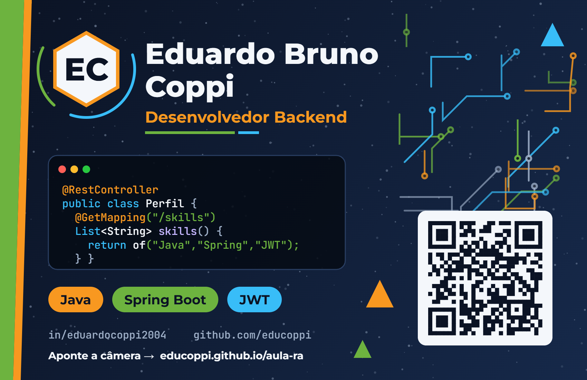

# Meu Cartão Profissional em Realidade Aumentada



---

## 1. Entregáveis

| # | Entregável | Link / arquivo |
|---|-----------|----------------|
| 1 | Imagem final do cartão (PNG) | [`assets/images/cartao.png`](assets/images/cartao.png) |
| 2 | Repositório com o código-fonte | https://github.com/educoppi/aula-ra |
| 3 | Aplicação publicada (GitHub Pages, HTTPS) | https://educoppi.github.io/aula-ra/ |
| 4 | Registro dos testes de tracking e conclusão | [Seção 6](#6-testes-de-tracking--quebre-sua-ra) deste documento |

---

## 2. Como usar

1. Abra **https://educoppi.github.io/aula-ra/** no navegador do celular (de preferência o Chrome).
2. Permita o acesso à câmera.
3. Aponte a câmera para o cartão, impresso ou aberto em outra tela. O QR code do cartão leva direto para a aplicação.
4. Quando o cartão é reconhecido, os blocos de informação aparecem sobre ele. Use as abas (na tela ou em 3D) para navegar.

---

## 3. Planejamento do cartão

- **Nome:** Eduardo Bruno Coppi
- **Área pretendida:** Desenvolvedor Backend
- **Identidade visual:** fundo azul-marinho escuro, com laranja (referência ao Java), verde (referência ao Spring) e azul-ciano como cores de destaque. A estética lembra um ambiente de programação: bloco de código, traçados de circuito e monograma "EC".

### Informações apresentadas em RA

| Bloco | Conteúdo |
|-------|----------|
| Cabeçalho | Nome e área profissional |
| Sobre mim | Desenvolvedor de Software com experiência em soluções ERP, focando em desenvolvimento backend em Java e Spring Boot |
| Habilidades | Java · Spring Boot · JWT |
| Projeto | [finance-dashboard](https://github.com/educoppi/finance-dashboard) |
| Formação | Tecnólogo em Análise e Desenvolvimento de Sistemas (cursando) |
| Contato | [LinkedIn](https://www.linkedin.com/in/eduardocoppi2004/) · [GitHub](https://github.com/educoppi) |

---

## 4. O target (imagem do cartão)

O cartão foi criado especialmente para esta atividade, em 1700 × 1100 px (proporção de um cartão de visita). Ele foi pensado para ser um **bom target** para o image tracking:

- **Alto contraste:** elementos claros e coloridos sobre fundo escuro.
- **Muitos detalhes e cantos:** letras grandes, bloco de código, chips coloridos, triângulos e traçados de circuito em posições irregulares.
- **Regiões visualmente distintas:** cada área do cartão é diferente das outras (monograma, nome, código, QR code, circuito). Isso evita padrões repetidos, que confundem o algoritmo.
- **QR code real:** além de ajudar no reconhecimento por ter muitos cantos, leva o usuário direto para a aplicação.

A imagem foi compilada no arquivo [`assets/targets/targets.mind`](assets/targets/targets.mind) com o compilador de Image Targets do MindAR. Esse arquivo guarda os pontos característicos do cartão que o MindAR procura na imagem da câmera.

---

## 5. A aplicação

### 5.1 Estrutura do projeto

```
aula-ra/
├── index.html              # cena A-Frame + MindAR e interface HTML
├── css/
│   └── style.css           # interface sobre a câmera (dica de escaneamento, abas, links)
├── js/
│   └── app.js              # conteúdo, texturas dos painéis, interações e eventos do MindAR
└── assets/
    ├── images/
    │   └── cartao.png      # imagem do cartão (target)
    └── targets/
        └── targets.mind    # target compilado pelo MindAR
```

### 5.2 Como funciona

- **MindAR** (`mindar-image`) acessa a câmera, **detecta** o cartão comparando a imagem com o `targets.mind` e, a cada quadro, calcula a **pose** do cartão (posição e rotação em relação à câmera).
- **A-Frame** monta a **cena**. Tudo o que está dentro da entidade `mindar-image-target` segue a pose do cartão, então os objetos virtuais "grudam" nele.
- O sistema de coordenadas da cena usa a largura do cartão como 1 unidade. As bordas ficam em x = ±0,5 e y ≈ ±0,32.
- Os painéis são planos (`a-plane`) com textura desenhada em `<canvas>` pelo `app.js`. Assim o texto fica nítido e aceita acentos.
- Os eventos `targetFound` e `targetLost` do MindAR controlam a animação de entrada dos blocos e a dica "Aponte a câmera para o cartão".
- O filtro de suavização do MindAR (`filterMinCF` / `filterBeta`) foi ajustado para reduzir o tremor dos objetos.

### 5.3 Blocos da experiência e uso de Transform

| Elemento | Onde aparece | Transform usado |
|----------|--------------|-----------------|
| Cabeçalho (nome + área) | Acima do cartão | **Position** animada: flutua para cima e para baixo |
| Logo 3D (prisma hexagonal) | Sobre o monograma "EC" impresso | **Rotation** contínua em torno do próprio eixo |
| Skills (Java, Spring Boot, JWT) | Sobre os chips impressos, "saltando" do cartão | **Position** em Z (profundidade) e **Scale** na entrada e ao tocar |
| Abas 3D | Logo abaixo do cartão | **Position** calculada para alinhar os 5 botões |
| Painel de informações | Abaixo das abas | **Rotation** de −12° em X (inclinado para o usuário) e **Scale** ao trocar de aba |

Todos os blocos entram com animação de **scale** (de 0 a 1), em sequência, quando o cartão é reconhecido.

### 5.4 Interatividade e legibilidade

- Abas **Sobre, Skills, Projeto, Formação e Contato**, clicáveis tanto em 3D quanto na barra inferior da tela. A barra tem botões grandes, mais fáceis de tocar no celular.
- Tocar em uma skill no cartão abre a aba Skills com ela destacada.
- Tocar no painel nas abas Projeto e Contato abre o repositório ou o LinkedIn.
- Botões fixos de LinkedIn, GitHub e Projeto no topo da tela.
- Moldura animada "Aponte a câmera para o cartão" enquanto o cartão não é reconhecido. Se a câmera for negada, aparece um aviso.
- Painéis com fundo escuro semitransparente, borda colorida e fonte grande, legíveis sobre qualquer fundo.

---

## 6. Testes de tracking — "Quebre sua RA"

Os testes foram feitos com a câmera do celular, sem alterar o código entre eles. A câmera usada tem qualidade baixa, o que influenciou os resultados.

| Condição | Hipótese | Resultado | Explicação |
|----------|----------|-----------|------------|
| **Visualização normal** | O cartão será reconhecido e os blocos aparecerão alinhados a ele. | **Funcionou** até cerca de **1 metro** de distância. | De frente, todos os pontos característicos do cartão ficam visíveis e sem distorção. O MindAR consegue compará-los com o `targets.mind` e calcular a pose. |
| **Maior distância** | Acima de certa distância o reconhecimento vai falhar, porque o cartão ficará pequeno na imagem. | **Não funcionou** a mais de 1 metro. | Quanto mais longe, menos pixels o cartão ocupa na imagem. Os detalhes finos (traçados, letras, módulos do QR code) se perdem e sobram poucos pontos característicos. Com uma câmera de baixa resolução, esse limite chega mais cedo. |
| **Cartão inclinado** | Com inclinação leve deve funcionar. Com inclinação forte, deve falhar. | **Não funcionou** com o cartão inclinado. | A perspectiva deforma e "achata" o cartão. Os pontos característicos aparecem distorcidos e espremidos e deixam de corresponder aos que foram salvos no `targets.mind`. A câmera de baixa qualidade piora o efeito: perde nitidez e o foco não pega o cartão inteiro, porque uma parte fica mais perto da lente que a outra. |
| **Cartão parcialmente coberto** | O tracking pode continuar se só uma pequena parte for coberta, mas deve falhar se uma área grande for escondida. | **Não funcionou** com o cartão parcialmente coberto. | Cobrir o cartão remove parte dos pontos característicos. Abaixo de uma quantidade mínima de correspondências, o MindAR não consegue estimar a pose com confiança e considera o target perdido. Somado à baixa qualidade da câmera, que já fornece menos pontos nítidos, o que restou visível não foi suficiente. |
| **Iluminação reduzida** | Com pouca luz o reconhecimento deve piorar ou falhar, por causa do ruído e da perda de contraste. | **Funcionou** com pouca luz. | O cartão tem **contraste muito alto**: elementos claros e coloridos sobre fundo escuro. Mesmo com menos luz, as bordas e os cantos continuam distinguíveis. A câmera também ajusta a exposição automaticamente. O resultado contrariou a hipótese e mostra a importância do design do target. |

### 6.1 Questão de análise

> **Por que o desempenho do reconhecimento e do tracking pode mudar mesmo quando o código da aplicação permanece exatamente o mesmo?**

Porque o MindAR não "enxerga" o cartão como uma pessoa. Ele trabalha com os **pontos característicos** que consegue extrair de cada quadro da câmera. O código só define *o que* procurar (o `targets.mind`) e *o que* exibir. Já a **qualidade da imagem de entrada** muda a cada situação e depende de fatores físicos fora do código:

- **Distância:** define quantos pixels o cartão ocupa e quantos detalhes sobrevivem.
- **Ângulo:** a perspectiva distorce os pontos e eles deixam de bater com o target compilado.
- **Oclusão:** reduz o número de pontos disponíveis para calcular a pose.
- **Iluminação:** afeta o contraste, o ruído e o desfoque de movimento.
- **Câmera:** resolução, foco automático, ruído do sensor e taxa de quadros variam muito entre aparelhos. Neste trabalho, a baixa qualidade da câmera foi um fator decisivo.
- **Suporte do cartão:** papel ou tela, com reflexos, brilho e moiré.

Ou seja: com o mesmo código, a entrada (imagem da câmera) muda, e por isso o resultado muda.

### 6.2 Conclusão dos testes

O cartão foi reconhecido de forma confiável na condição ideal (de frente, até cerca de 1 m) e manteve o reconhecimento mesmo com pouca luz, graças ao alto contraste do design. Por outro lado, o tracking se mostrou sensível a distâncias maiores, à inclinação e à oclusão parcial. Nesses três casos o número de pontos característicos visíveis e nítidos cai abaixo do necessário, e a câmera de baixa qualidade usada nos testes amplificou essa limitação.

Os testes mostram que o desempenho de uma aplicação de RA baseada em imagem depende tanto do **target** e das **condições físicas** quanto do código.

---

## 7. Referências

- MindAR — documentação: https://hiukim.github.io/mind-ar-js-doc/
- MindAR — exemplos: https://hiukim.github.io/mind-ar-js-doc/examples/basic/
- A-Frame — documentação: https://aframe.io/docs/
- GitHub Pages — documentação: https://docs.github.com/pages
